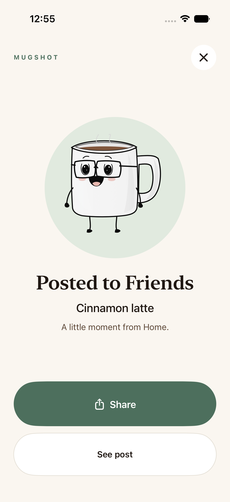
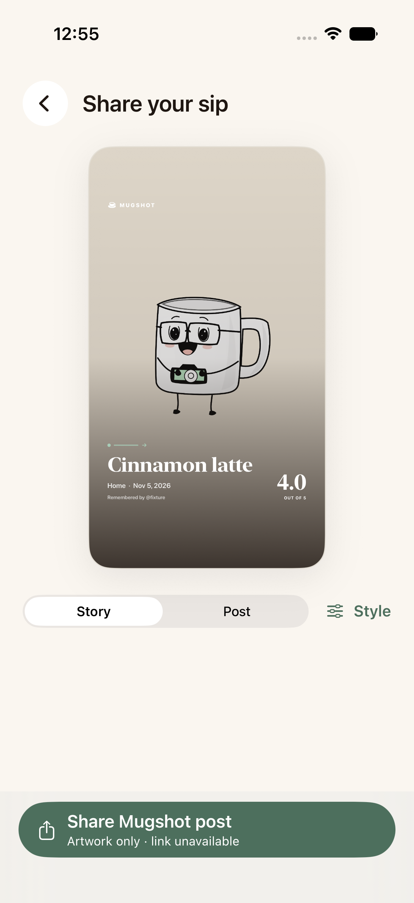
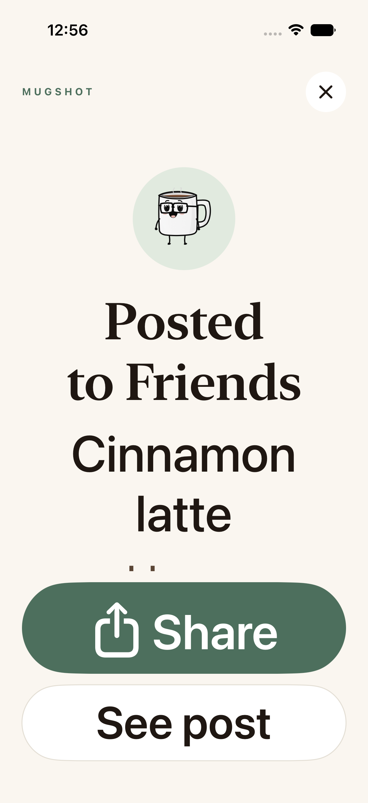

# Recipe focus and full-screen post result

Native SwiftUI implementation installed in **Mugshot Luna QA 0.5.3 (8)**.
The tighter `gpt-6-luna` provider is live as function version 4. All 52 isolated
iPhone checks and the separate owner read-only component check pass. Real owner
publication/external sharing and original-source fidelity remain human QA.
The existing saved PSL version is preserved. Parent drafts and TestFlight stay held.

The result uses the existing Mugsy animation and palette. Share opens a focused
artwork preview; See post uses existing owned detail routing. Private saves retain
their private receipt. Large text keeps fixed bottom actions and scrollable content;
Reduce Motion retains a static acknowledgment. No new artwork or animation package
is added to the runtime.

These captures use fictional Jamie/Cinnamon latte data on Simulator. Private
hardware screenshots and all owner source/backups remain outside the repository.

| Full-screen result | Clean sharing | Largest text |
| --- | --- | --- |
|  |  |  |

[Full ECC, hosted deployment, hardware and preservation ledger](../../audits/RECIPE_FOCUS_AND_POST_CELEBRATION_2026-11-05.md).
[Sanitized verification receipt](verification.json).
